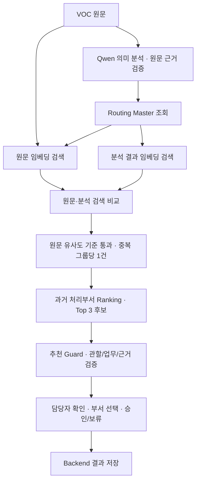

# 원문·분석 비교 검색과 후보 추천

## 변경 목적

기존 방식은 Qwen이 요지를 잘못 선택하면 잘못된 업무 후보 안에서 검색했습니다. 이제 원문 검색을 독립적으로 수행합니다. Qwen 분석이 실패하거나 업무 Master 연결이 없어도 원문과 유사한 과거 사례를 찾아 담당 부서 후보를 제공합니다. 확정된 사건 관할과 전국형 scope는 원문 검색에서도 유지합니다. 원문 모순 검사와 의미 검증을 통과한 업무기능은 원문 검색에도 적용합니다. 검증 실패나 Master 업무 연결 공백이 있으면 업무 조건을 풀고 참고 후보를 찾습니다.

## 구조 흐름



### 두 검색의 역할

| 단계 | 입력 | 역할 |
|---|---|---|
| 원문 검색 | VOC 원문 | 별도 원문 벡터로 관련 사례 탐색; 검증된 업무 조건 적용 |
| 분석 검색 | 의도, 핵심 요청, 요지, 키워드, 검증된 원인 | 의미 분석이 같은 사례를 찾는지 비교 |
| 비교 | 두 검색의 사례 ID와 과거 처리부서 집합 | 일치 사례 수와 부서 후보 불일치 표시 |
| 후보 구성 | 원문 유사도 기준을 충족한 독립 사례 | 분석 검색만 일치하는 사례가 후보를 오염시키지 않도록 제한 |

분석 검색 텍스트에는 원문을 다시 넣지 않습니다. 두 검색의 인덱스는 별도로 저장됩니다. 원문 인덱스는 holdout의 검색이력만 사용하며, 과거 Qwen 분석 실패 때문에 해당 원문까지 검색에서 사라지지 않습니다. 분석 인덱스는 기존 의미 검증을 통과한 이력만 사용합니다.

평가 대상의 `handling_team`과 정답 요지코드는 검색 입력에 사용하지 않습니다. 과거 이력의 `handling_team`은 기존과 같이 부서 Ranking의 근거입니다.

## 후보와 최종 추천의 차이

원문 근거 후보는 계속 제시합니다. 두 검색의 부서 집합이 겹치지 않거나 분석 검색에 근거가 없으면 불일치로 표시합니다. 업무·관할이 불확실하거나 분석 실패가 있으면 후보를 참고용으로 표시하고 최종 추천은 확인대기로 둡니다. 과거 사례에 붙은 지역은 현재 VOC의 확정 관할로 표시하지 않습니다.

원문 검색의 유사도 기준은 `MIN_SIMILARITY=0.55`, 짧은 분석 텍스트 비교 기준은 `ANALYSIS_MIN_SIMILARITY=0.35`입니다. 서로 다른 입력 길이의 검색 기준이며 초기값입니다. 정확도 확률이나 검증된 최적값이 아닙니다.

두 검색이 일치해도 정답이라는 뜻은 아닙니다. 최종 추천은 기존 Master 적합성, 최소 유사도, 독립 근거 수, 점수 차이 검증을 추가로 통과해야 합니다. 승인은 담당자의 명시적인 버튼 조작으로만 저장됩니다.

부서 점수는 기존 `0.7 × 평균 원문 유사도 + 0.3 × 독립 사례 비중`을 유지합니다. 분석 유사도를 혼합해 정확도 확률처럼 표시하지 않습니다. 이 비율의 최적성은 아직 검증하지 않았습니다.

## 화면에서 읽는 방법

처리부서 추천 영역의 **검색 결과 비교**에서 다음을 확인합니다.

- 원문 근거: 원문 유사도 기준을 통과한 독립 사례 수
- 분석 근거: 분석 검색에서 기준을 통과한 독립 사례 수
- 동일 사례: 두 검색에 함께 나온 사례 수
- 불일치: 원문과 분석의 부서 후보 집합이 겹치지 않거나 분석 근거가 없는 상태

분실물 VOC가 잘못된 시설 요지로 분류되어도 원문 검색에서는 분실물 관련 사례를 찾을 수 있습니다. 해당 후보와 분석 검색의 시설 후보가 충돌하면 이를 숨기지 않고 담당자에게 보여줍니다. Qwen 요지를 자동으로 정답 라벨로 바꾸지는 않습니다.

## 파일과 실행

- `backend/dual_retrieval.py`: 분리 검색, 캐시, 비교, 중복 제거, 기존 Ranking 재사용
- `backend/service.py`: 실시간 C 모드 연결, 결과 저장과 상세 API 노출
- `voc-ui/dist/app.js`: 기존 디자인 안에 검색 비교 표시
- `scripts/test_dual_real.py`: 실제 모델·데이터 검증, 운영 DB를 별도 검증 DB로 복제
- `tests/test_dual_retrieval.py`: 입력 누수 방지, 중복 근거, 관할 보호, 분석 실패 검색, JSON null 검증
- `scripts/test_dual_browser.py`: 실제 저장 결과를 사용한 검색 비교·불일치·참고 후보 화면 검증

기존 실행 명령을 사용합니다. 실행 중인 서버는 코드 적용을 위해 재시작해야 합니다.

```bash
conda activate voc
uvicorn backend.main:app --host 127.0.0.1 --port 8001
python -m pytest -q
python scripts/test_dual_real.py
```

캐시는 `OUTPUT_PATH` 아래 `dual-raw-*.npz`, `dual-analysis-*.npz`에 저장합니다. 모델명, 검색 전처리 버전, VOC ID와 검색 텍스트가 바뀌면 새 캐시를 만듭니다. 최초 요청에서 필요한 캐시를 한 번 만들고 이후 메모리와 파일에서 재사용합니다. 원문 Excel은 변경하지 않습니다.

## 한계

- 원문 임베딩도 비슷한 단어를 가진 다른 문제를 검색할 수 있습니다.
- 현재 비교는 사례와 부서 집합 기준입니다. 같은 부서가 겹쳐도 개별 사례의 의미가 모두 맞는다는 보장은 없습니다.
- Qwen의 잘못된 요지 자체를 이 변경이 자동 교정하지는 않습니다.
- 지역이 미확정이면 다른 지역의 과거 처리부서는 참고 후보로 남습니다.
- 최초 인덱스 생성은 이후 요청보다 오래 걸립니다.
- A/B는 기존 검색 비교 기준이고 C는 변경된 원문·분석 비교 방식입니다. 이전 C 평가 수치와 직접 비교할 때 버전을 구분해야 합니다.
- BERTopic은 별도 누적 분석이며 실시간 추천 필수 단계로 들어가지 않습니다.

## 실제 검증 결과

54개 자동 테스트를 통과했습니다. 실제 MiniLM 임베딩과 Qwen3.5-2B 분석 결과를 사용해 네 사례를 확인했습니다. 운영 DB의 승인 데이터는 테스트에서 변경하지 않았습니다.

| 사례 | 원문 근거 / 분석 근거 / 동일 사례 | 결과 |
|---|---|---|
| 열차 내 분실물 확인 | 10 / 0 / 0 | Qwen D4 오분류를 원문 모순으로 표시; 여객 관련 참고 후보 표시 |
| 무궁화호 객실 벌레 | 4 / 10 / 0 | 검증된 차량 업무 조건 적용; 차량처 참고 후보 표시 |
| 응급 도움 칭찬 | 10 / 0 / 0 | 업무 Master 공백에도 여객 관련 참고 후보 표시 |
| 에스컬레이터 | 4 / 5 / 4 | 부산경남본부 시설처 추천가능 |

앞의 세 사례는 확정 관할·업무 또는 근거가 부족하여 자동 확정하지 않았습니다. 네 사례 결과를 전체 holdout 성능 향상의 증거로 해석할 수는 없습니다. 상세 기록은 `outputs/dual_validation/report.json`에 저장합니다.

브라우저 검증에서는 실제 저장된 분석 결과를 API fixture로 전달했습니다. 실시간 모델 요청과 화면 렌더링 검증은 별도로 수행했으며, 브라우저 테스트가 새 모델 추론을 실행한 것은 아닙니다.

### 8001 서버 최종 확인

실제 `/api/vocs`는 holdout 512건을 반환했습니다. 분실물 사례의 분석 API 실행 후 원문 근거 10건과 여객 관련 Top-3 참고 후보가 저장되었습니다. 강화된 원문 모순 검사로 잘못된 분석 업무 검색은 차단되어 분석 근거는 0건으로 표시되었습니다. 원문 검색은 계속 실행되었습니다.

동일 상세 API를 다시 조회해 저장 결과가 유지되는 것을 확인했고 승인 건수는 변하지 않았습니다. 실제 브라우저에서도 검색 비교·불일치·후보가 표시되며, 새로고침 후 추가 분석 POST나 승인 POST가 발생하지 않았습니다. 기록은 `outputs/dual_validation/live-detail.json`, 화면은 `outputs/dual_validation/live_8001.png`입니다.

서버의 과거 이력 준비가 진행되면 분석 인덱스의 건수는 달라질 수 있습니다. 표는 검증 시점의 결과이며 전체 평가 지표가 아닙니다.
